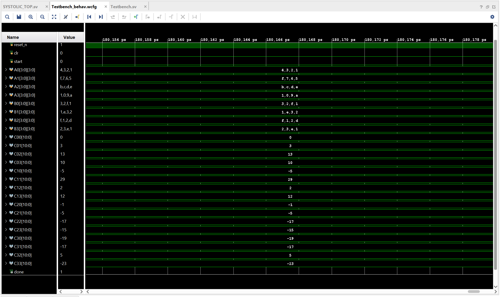

# Systolic Array MAC Unit in SystemVerilog

## Overview

This project implements a 4×4 systolic array-based Multiply-Accumulate (MAC) unit using SystemVerilog. The architecture consists of 16 Processing Elements (PEs) arranged in a 4×4 grid to perform parallel signed multiplication and accumulation.

Each PE uses Booth multiplication to calculate the product of signed 4-bit operands and accumulates the results in an 11-bit register. Input and weight buffers employ pipelined data movement and skewing to synchronize operand delivery across the array.

An FSM-based controller coordinates matrix loading, computation, pipeline flushing, and completion signaling. The design is verified through simulation using a dedicated SystemVerilog testbench.

---

## Features

* SystemVerilog implementation
* 4×4 systolic array comprising 16 Processing Elements
* Signed 4-bit Booth multiplication
* 11-bit accumulators within each PE
* Pipelined input and weight propagation
* Input and weight buffers with skewing
* FSM-based control logic
* Synchronous accumulation with asynchronous active-low reset
* Clear functionality for resetting intermediate results
* Simulation-based functional verification

---

## Architecture

Input Matrix A (4×4)

↓

Input Buffer and Skewing

↓

4×4 Systolic Array (16 PEs) ← Weight Buffer and Skewing

↓

Signed Multiplication and Partial-Sum Accumulation

↓

4×4 Output Matrix C

---

## Processing Element (PE)

Each Processing Element performs the following operations:

1. Receives signed 4-bit input and weight operands.
2. Computes their product using Booth multiplication.
3. Accumulates the product into an 11-bit result register.
4. Forwards the input and weight operands to neighboring PEs.

The PEs operate concurrently, enabling parallel computation with pipelined data propagation.

---

## Controller FSM

The control unit manages the execution sequence through five states:

* **IDLE:** Waits for the start signal.
* **LOAD:** Loads input and weight matrices into their respective buffers.
* **COMPUTE:** Enables operand propagation through the systolic array.
* **FLUSH:** Allows remaining pipeline operations to complete.
* **DONE:** Signals completion of the computation.

---

## Tools Used

* SystemVerilog
* Xilinx Vivado
* SystemVerilog Testbench

---

## Project Structure

```text
SYSTOLIC_MAC/
├── mac_2_systolic.sv
├── mac_2_systolic_tb.sv
├── README.md
└── Simulation Outputs
```

---

## Simulation Results

### 1. Output Waveform

The waveform illustrates the operation of the systolic array, including clock, reset, control signals, and output completion.



### 2. Output Matrix

The output matrix shows the computed results generated by the systolic array during simulation.


## FPGA Resource Utilization

The design was synthesized using Xilinx Vivado to evaluate FPGA resource utilization.

| Resource        | Used | Available |      Utilization |
| --------------- | ---: | --------: | ---------------: |
| Slice LUTs      |  742 |    41,000 |            1.81% |
| Slice Registers |  504 |    82,000 |            0.61% |
| F7 Multiplexers |   64 |    20,500 |            0.31% |
| Bonded IOBs     |  309 |       300 | Exceeds capacity |


### Resource Analysis

* **LUTs:** 742 LUTs are utilized for combinational logic, including multiplication, arithmetic, and control operations.
* **Registers:** 504 slice registers are used for operand propagation, intermediate results, buffers, and control logic.
* **Systolic Array:** The 16-PE array accounts for 441 LUTs and 272 slice registers.
* **I/O Resources:** The design requires 309 bonded I/O resources, exceeding the selected device's capacity of 300. Further optimization is required before FPGA implementation.


## Activation Functions (Python/PyTorch)

The MAC output from the 4×4 systolic array is exported to `mac_output.txt` and processed using Python and PyTorch.

Implemented activation functions:

* **ReLU:** Sets negative values to zero.
* **Sigmoid:** Maps values to (0, 1).
* **Tanh:** Maps values to (-1, 1).
* **Softmax:** Normalizes each row into a probability distribution.

### Results


## Future Improvements

* Increase accumulator width to support larger accumulation ranges.
* Integrate the array into a CNN convolution accelerator.
* Implement configurable array dimensions and operand widths.
* Optimize controller timing and systolic data scheduling.
* Deploy the design on an FPGA for hardware validation.
